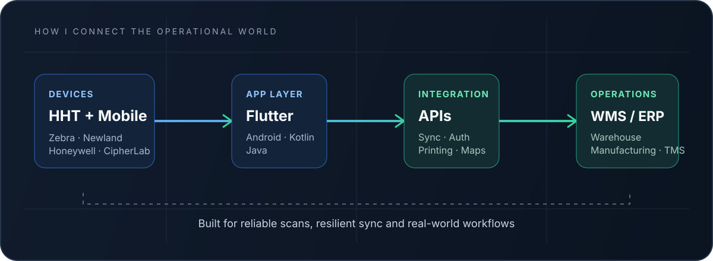

 

# VINAY KUMAR

### ANDROID & FLUTTER ENGINEER

**I turn complex operations into dependable mobile products.**

 

  

---

01 &nbsp; / &nbsp; THE ENGINEER BEHIND THE SCREEN

## More than screens. Systems that move work forward.

I'm an **Android and Flutter Engineer with 3+ years of experience** building mobile applications for warehouse, manufacturing, logistics, and business operations.

My sweet spot is where software meets the physical world: handheld barcode scanners, warehouse workflows, Bluetooth printers, offline data, APIs, and the people who depend on them every day.

I work across the complete mobile lifecycle—from understanding an operational problem and shaping the architecture to integrating devices, testing edge cases, and shipping releases.

<table>
<tr>
<td width="33%" valign="top">

**01 — OPERATIONS**

Warehouse, inventory, inbound, picking, dispatch, manufacturing and transport workflows.

</td>
<td width="33%" valign="top">

**02 — MOBILE**

Flutter, native Android, Kotlin, Java, scalable architecture and state management.

</td>
<td width="33%" valign="top">

**03 — INTEGRATION**

HHT scanners, REST APIs, offline storage, synchronization and thermal printing.

</td>
</tr>
</table>

02 &nbsp; / &nbsp; HOW I THINK ABOUT SYSTEMS

---

03 &nbsp; / &nbsp; SELECTED WORK

# Products & Platforms

*Different industries. One consistent focus: dependable mobile workflows.*

<table>
<tr>
<td width="50%" valign="top">

### 01 / SKL-WMS

**Warehouse Management System**

A warehouse execution platform covering vehicle gate entry, inward, GRN verification, putaway, bin and location management, inventory validation, picking, dispatch, and gatepass workflows.

**Flutter** · **Riverpod** · **REST APIs** · **Newland HHT**

</td>
<td width="50%" valign="top">

### 02 / PRECAST ERP

**Manufacturing Operations**

Mobile workflows for concrete batching, mold scanning, casting, curing and WIP monitoring, quality approvals, purchase orders, GRN processing, supplier payment milestones, and dispatch.

**Flutter** · **Riverpod** · **Newland HHT** · **ML Kit**

</td>
</tr>
<tr>
<td width="50%" valign="top">

### 03 / KBR TMS

**Transport Management System**

Transport workflows for vehicle placement and allocation, trip execution, map-based tracking, digital Proof of Delivery, customer and supplier billing, approval flows, notifications, and offline caching.

**Flutter** · **Provider** · **Riverpod** · **Hive** · **Google Maps**

</td>
<td width="50%" valign="top">

### 04 / ENTERPRISE HHT WMS

**Warehouse Device Integrations**

Scanner-driven inward, sorting, grading, picklists, shipment and returns. Includes native hardware integration, scan history, Bluetooth label printing, and API synchronization.

**Flutter** · **Android** · **Java** · **Zebra** · **Honeywell**

</td>
</tr>
<tr>
<td width="50%" valign="top">

### 05 / WMS VENDOR PORTAL

**Vendor & Goods Movement**

Role-based vendor workflows for purchase-order creation and tracking, challan and invoice generation, and goods movement.

**Flutter** · **Provider** · **REST APIs**

</td>
<td width="50%" valign="top">

### 06 / CRM-AL

**AtharvLogix CRM**

Cross-platform CRM foundation designed for employee and customer workflows, offline data entry and synchronization, and secure session handling.

**Flutter** · **BLoC** · **Drift** · **GetIt** · **GoRouter**

</td>
</tr>
<tr>
<td width="50%" valign="top">

### 07 / TAZALO TASKS

**Workspace-based Task Management**

Multi-company workspace switching, task views for mine, assigned, review and overdue work, notifications, and authenticated API integration.

**Flutter** · **Riverpod** · **Dio** · **GoRouter**

</td>
<td width="50%" valign="top">

### 08 / SALES CRM

**Offline-first Lead Management**

Feature-first CRM implementation with authentication, session management, and API-integrated lead listing.

**Flutter** · **BLoC / Cubit** · **Drift** · **Dio**

</td>
</tr>
</table>

<b>Other shipped applications</b> — internal tools and enterprise apps

- **SLL-Ticketing** — support tickets, analytics and ticket lifecycle management.
- **SLL-VMS** — visitor data capture and management.
- **Seabird-EMS** — expense management workflows.

Some projects are proprietary enterprise applications. Internal source code, customer data, and private deployment details are intentionally not published.

---

04 &nbsp; / &nbsp; ENGINEERING TOOLKIT

# Tools of the trade

<table>
<tr>
<td width="24%" valign="top">

**Languages**

</td>
<td>

</td>
</tr>
<tr>
<td valign="top">

**Mobile**

</td>
<td>

</td>
</tr>
<tr>
<td valign="top">

**Architecture**

</td>
<td>

**Clean Architecture** &nbsp; · &nbsp; **Feature-first** &nbsp; · &nbsp; **MVVM** &nbsp; · &nbsp; **Repository Pattern**

**BLoC / Cubit** &nbsp; · &nbsp; **Riverpod** &nbsp; · &nbsp; **Provider** &nbsp; · &nbsp; **GetIt** &nbsp; · &nbsp; **GoRouter**

</td>
</tr>
<tr>
<td valign="top">

**Data & APIs**

</td>
<td>

**Dio** &nbsp; · &nbsp; **REST APIs** &nbsp; · &nbsp; **Drift** &nbsp; · &nbsp; **SQLite** &nbsp; · &nbsp; **Hive**

**SharedPreferences** &nbsp; · &nbsp; **Flutter Secure Storage** &nbsp; · &nbsp; **Firebase** &nbsp; · &nbsp; **FCM**

</td>
</tr>
<tr>
<td valign="top">

**Hardware**

</td>
<td>

**Zebra DataWedge / EMDK** &nbsp; · &nbsp; **Newland NLS SDK**

**Honeywell** &nbsp; · &nbsp; **CipherLab** &nbsp; · &nbsp; **Bluetooth Printing** &nbsp; · &nbsp; **ESC/POS** &nbsp; · &nbsp; **ZPL**

</td>
</tr>
<tr>
<td valign="top">

**Workflow**

</td>
<td>

</td>
</tr>
</table>

---

05 &nbsp; / &nbsp; ENGINEERING IN THE REAL WORLD

# Impact from production workflows

<table>
<tr>
<td align="center" width="25%">

# 500+

**Daily scans**

</td>
<td align="center" width="25%">

# 1,000+

**Labels / day**

</td>
<td align="center" width="25%">

# 70%

**Less manual entry**

</td>
<td align="center" width="25%">

# 95%

**ML Kit accuracy**

</td>
</tr>
</table>

These are previously documented project-level figures from warehouse deployments, not universal guarantees. Actual results vary by workflow and deployment.

---

06 &nbsp; / &nbsp; THE JOURNEY

# Experience

### Android Developer · Sat Kabir Logistics

**APR 2026 — PRESENT** &nbsp; · &nbsp; **GURUGRAM, INDIA**

- Developing production Android and Flutter applications for warehouse, manufacturing, and logistics operations.
- Delivering WMS workflows across inward, GRN, putaway, inventory, picking, dispatch, and gatepass operations.
- Integrating Newland handheld devices through the NLS SDK for native barcode-scanning workflows.
- Implementing precast ERP workflows across production, quality control, procurement, and dispatch.
- Building REST API integrations, local persistence, and device-level scanning and printing capabilities.

### Software Developer (Android & Flutter) · Seabird Logisolutions

**JUL 2023 — APR 2026**

- Engineered and deployed 7 production applications used by 50–200 field staff across logistics and warehouse operations.
- Built HHT scanning workflows using Zebra EMDK, DataWedge, and ML Kit.
- Implemented Bluetooth printing with ESC/POS and ZPL support across Zebra and Honeywell devices.
- Developed Proof of Delivery workflows with image capture and REST API synchronization.
- Integrated Firebase authentication, real-time database, push notifications, and analytics.
- Owned features end-to-end, from implementation through Play Store deployment.

---

07 &nbsp; / &nbsp; OPEN SOURCE FOOTPRINT

# The GitHub side of things

&nbsp;

 

---

08 &nbsp; / &nbsp; THE NEXT CONNECTION

# Have a real-world problem to solve?

I'm interested in Android and Flutter engineering opportunities where mobile software, operational workflows, and thoughtful engineering come together.

**Gurugram, India** &nbsp; · &nbsp; Open to relevant opportunities

 

  

*I build for the people moving things forward.*

