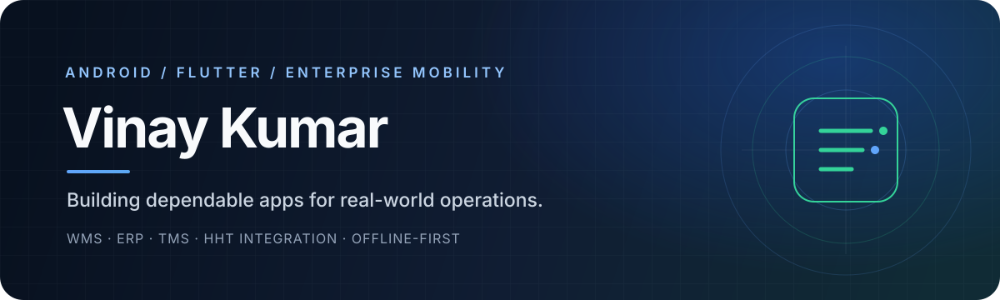

### Android & Flutter Engineer · Enterprise Mobility Specialist

Building production applications for **warehouse, manufacturing, transport, and business operations**.

---

## About

I'm an **Android and Flutter Engineer** with 3+ years of experience building and supporting enterprise mobile applications.

My work focuses on turning complex operational processes into reliable mobile workflows — from barcode-driven warehouse operations and manufacturing ERP to transport management, offline-first apps, API integrations, and thermal printing.

- **Core domains:** WMS · ERP · TMS · CRM · Enterprise mobility
- **Mobile development:** Flutter, Dart, Android, Kotlin, Java
- **Device integrations:** Zebra, Honeywell, Newland, CipherLab
- **Engineering focus:** Clean Architecture, MVVM, BLoC, Riverpod, offline-first systems
- **Based in:** Gurugram, India

> I enjoy solving the engineering problems that make enterprise apps dependable: device compatibility, scan reliability, synchronization, printing, and resilient API workflows.

## What I Build

<table>
<tr>
<td width="50%" valign="top">

### 📦 Warehouse & Logistics
- Inward, GRN and putaway
- Inventory and bin management
- Picking, packing and dispatch
- Barcode scanning on HHT devices
- Challan, labels and thermal printing

</td>
<td width="50%" valign="top">

### 🏭 Business & Operations
- Precast manufacturing workflows
- Production and quality tracking
- Transport and trip management
- Proof of Delivery and billing
- CRM and task-management apps

</td>
</tr>
<tr>
<td width="50%" valign="top">

### ⚙️ Mobile Engineering
- Feature-first architecture
- MVVM, BLoC and Riverpod
- REST API integration
- Secure session management
- Local storage and offline sync

</td>
<td width="50%" valign="top">

### 🔌 Hardware & Integrations
- Zebra DataWedge / EMDK
- Newland NLS SDK
- Honeywell and CipherLab devices
- Bluetooth printer integration
- Firebase and push notifications

</td>
</tr>
</table>

## Technology Stack

**Languages & Mobile**

**Backend, Data & Developer Tools**

| Area | Tools & Technologies |
|---|---|
| Architecture | Clean Architecture, Feature-First, MVVM, Repository Pattern |
| State management | BLoC / Cubit, Riverpod, Provider |
| Networking | Dio, REST APIs, JSON |
| Local data | Drift, SQLite, Hive, SharedPreferences |
| Security | Flutter Secure Storage, token-based authentication |
| Device integration | Zebra DataWedge / EMDK, Newland NLS SDK, Honeywell, CipherLab |
| Printing | Bluetooth, ESC/POS, ZPL |
| Services | Firebase, FCM, Google Maps |

## Selected Impact

Operational figures are based on project-level metrics documented for warehouse deployments; results may vary by workflow and deployment.

## Featured Projects

### 01 · SKL-WMS — Warehouse Management System
Flutter · Dart · Riverpod · REST APIs · Newland HHT

Warehouse execution workflows covering vehicle gate entry, inward operations, GRN verification, putaway, bin/location management, inventory validation, picking, dispatch, and gatepass operations. Includes native Newland handheld barcode integration and Bluetooth thermal printing.

### 02 · PRECAST ERP — Manufacturing Operations
Flutter · Dart · Riverpod · REST APIs · Newland HHT · ML Kit

Manufacturing workflows covering concrete batching, mold scanning, casting, curing and WIP monitoring, quality approvals, purchase orders, GRN processing, supplier payment milestones, and dispatch. Also includes HHT scanning and document generation.

### 03 · KBR TMS — Transport Management System
Flutter · Dart · Provider / Riverpod · Hive · REST APIs · Google Maps · Firebase FCM

Transport-management work covering vehicle placement and allocation, trip execution, map-based tracking, digital Proof of Delivery, billing and approval workflows, notifications, and offline caching.

### 04 · Enterprise HHT WMS
Flutter · Android · Java · Zebra DataWedge / EMDK · Honeywell SDK

Warehouse scanning workflows for inward, sorting, grading, picklists, shipment handling, and returns. Integrated hardware scanning, scan history, print preview, Bluetooth label printing, and API synchronization.

### 05 · WMS Vendor Portal
Flutter · Provider · REST APIs

A vendor-facing application for role-based access, purchase-order creation and tracking, challan and invoice generation, and goods-movement workflows.

### 06 · CRM-AL — AtharvLogix CRM
Flutter · BLoC · Dio · GetIt · Drift · GoRouter

Cross-platform CRM foundation designed for employee and customer workflows, with offline data entry and synchronization, secure session handling, and feature-first Clean Architecture.

### 07 · Tazalo Tasks
Flutter · Riverpod · GoRouter · Dio · Flutter Secure Storage

Task-management application with multi-workspace switching, task views for personal, assigned, review, and overdue work, notifications, and authenticated multi-company API integration.

### 08 · Sales CRM
Flutter · BLoC / Cubit · Drift · GetIt · GoRouter

Offline-first CRM implementation with authentication, session management, and API-integrated lead listing using feature-first Clean Architecture.

### 09 · SLL-Ticketing
Flutter · MVVM · REST APIs · Firebase

Internal support-ticket application with secure login, analytics dashboards, ticket lifecycle management, and operational workflows.

Some projects are proprietary enterprise applications. Internal source code, customer data, and private deployment details are intentionally not published.

## Experience

### Android Developer · Sat Kabir Logistics
April 2026 — Present · Gurugram, India

- Developing production Android and Flutter applications for warehouse, manufacturing, and logistics operations.
- Delivering WMS workflows across inward, GRN, putaway, inventory, picking, dispatch, and gatepass operations.
- Integrating Newland handheld devices through the NLS SDK for native barcode-scanning workflows.
- Implementing precast ERP workflows across production, quality control, procurement, and dispatch.
- Building REST API integrations, local persistence, and device-level scanning / printing capabilities.

### Software Developer (Android & Flutter) · Seabird Logisolutions
July 2023 — April 2026

- Engineered and deployed 7 production applications used by 50–200 field staff across logistics and warehouse operations.
- Built HHT scanning workflows using Zebra EMDK, DataWedge, and ML Kit.
- Implemented Bluetooth printing with ESC/POS and ZPL support across Zebra and Honeywell devices.
- Developed Proof of Delivery workflows with image capture and REST API synchronization.
- Integrated Firebase authentication, real-time database, push notifications, and analytics.
- Owned features end-to-end, from implementation through Play Store deployment.

## GitHub Activity

## Let's Connect

I'm interested in **Android / Flutter engineering opportunities** where I can contribute to product development, enterprise mobility, and reliable business applications.

**Gurugram, India** · Open to relevant opportunities

 

*“Build for the real world. Make every scan, sync, and screen count.”*

