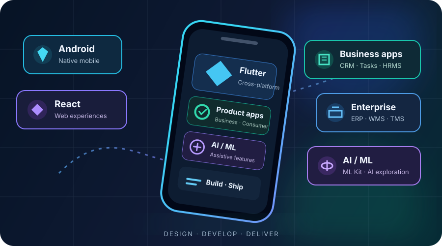

<table width="100%">
<tr>
<td width="64%" valign="middle">

<h1>Vinay Kumar</h1>

<h3>Android & Flutter Engineer · Mobile Product Developer</h3>

<b>Mobile Apps · Business Platforms · Productivity · Enterprise Solutions · AI/ML</b>

I build thoughtful, reliable mobile applications across different domains—from CRM and task management to customer-facing products and connected enterprise systems.

</td>
<td width="36%" align="center" valign="middle">

</td>
</tr>
</table>

---

<h2>⚡ Core Expertise</h2>

<table width="100%">
<tr>
<td align="center" width="16%"><b>📱 Mobile Development</b> Android · Flutter · iOS via Flutter</td>
<td align="center" width="16%"><b>💼 Business Apps</b> CRM · HRMS · Sales</td>
<td align="center" width="16%"><b>✅ Productivity</b> Tasks · Ticketing · Workflows</td>
<td align="center" width="16%"><b>🏢 Enterprise</b> ERP · WMS · TMS</td>
<td align="center" width="18%"><b>🧱 Architecture</b> MVVM · Clean · Offline-first</td>
<td align="center" width="18%"><b>🧠 AI & Integration</b> ML Kit · APIs · Hardware</td>
</tr>
</table>

---

<table width="100%">
<tr>
<td width="20%" valign="top">

<h2>📊 Impact</h2>

<table width="100%">
<tr><td><h2>7+</h2><b>Production apps</b> Delivered at Seabird</td></tr>
<tr><td><h2>50–200</h2><b>Daily field users</b> Across deployed apps</td></tr>
<tr><td><h2>500+</h2><b>Daily scans</b> Warehouse deployment</td></tr>
<tr><td><h2>1,000+</h2><b>Labels / day</b> Printing workflows</td></tr>
<tr><td><h2>70%</h2><b>Less manual entry</b> Reported project impact</td></tr>
<tr><td><h2>95%</h2><b>ML Kit accuracy</b> Reported scanning result</td></tr>
</table>

Operational figures relate to specific deployments and are not universal product guarantees.

</td>
<td width="54%" valign="top">

<h2>🚀 Featured Projects</h2>

<table width="100%">
<tr>
<td width="50%" valign="top">

<h3>🟣 CRM-AL</h3>
<b>Sales & Customer Relationships</b>

CRM foundation for employee and customer workflows, offline entry, synchronization and secure sessions.

Flutter · BLoC · Drift · GetIt

</td>
<td width="50%" valign="top">

<h3>🟢 Tazalo Tasks</h3>
<b>Productivity & Team Work</b>

Multi-workspace task management, personal and assigned tasks, reviews, overdue work and notifications.

Flutter · Riverpod · Dio

</td>
</tr>
<tr>
<td valign="top">

<h3>🔵 Sales CRM</h3>
<b>Lead Management</b>

Offline-first lead workflows with authentication, session management and API-integrated lead listing.

Flutter · BLoC · Drift

</td>
<td valign="top">

<h3>🟠 SLL-Ticketing</h3>
<b>Support Management</b>

Internal ticketing workflows, ticket lifecycle management and dashboard analytics.

Flutter · MVVM · REST APIs

</td>
</tr>
<tr>
<td valign="top">

<h3>🟦 PRECAST ERP</h3>
<b>Manufacturing Operations</b>

Production, mold scanning, casting, curing, WIP, quality approvals, procurement and dispatch.

Flutter · Riverpod · Newland HHT

</td>
<td valign="top">

<h3>🟩 SKL-WMS</h3>
<b>Warehouse Operations</b>

Gate entry, inward, GRN, putaway, inventory, picking, dispatch and handheld scanning.

Flutter · Riverpod · Newland SDK

</td>
</tr>
<tr>
<td valign="top">

<h3>🚚 KBR TMS</h3>
<b>Transport Management</b>

Vehicle allocation, trip execution, map tracking, Proof of Delivery, billing and offline caching.

Flutter · Google Maps · Hive

</td>
<td valign="top">

<h3>📦 WMS Jamnagar</h3>
<b>Enterprise Warehouse Platform</b>

Inbound, shipment and inventory modules with feature-first architecture and secure API integration.

Flutter · MVVM · Riverpod

</td>
</tr>
<tr>
<td colspan="2" valign="top">

<h3>➕ Other Applications</h3>
<b>HRMS · WMS Vendor Portal · Visitor Management · Expense Management</b> 
Additional business applications and internal tools across different operational domains.

</td>
</tr>
</table>

</td>
<td width="26%" valign="top">

<h2>💼 Experience</h2>

<h3>Android Developer</h3>
<b>Sat Kabir Logistics</b> 
Apr 2026 – Present

<ul>
<li>Building Android and Flutter applications for manufacturing and business workflows.</li>
<li>Developing ERP and WMS modules with API and local data integration.</li>
<li>Integrating Newland HHT devices through the NLS SDK.</li>
<li>Working across architecture, implementation and release readiness.</li>
</ul>

<h3>Software Developer</h3>
<b>Seabird Logisolutions</b> 
Jul 2023 – Apr 2026

<ul>
<li>Delivered 7 production mobile apps across multiple business workflows.</li>
<li>Built Flutter and native Android features with REST APIs and Firebase.</li>
<li>Integrated Zebra and Honeywell scanning and Bluetooth printing.</li>
<li>Worked on ticketing, visitor, expense and warehouse applications.</li>
<li>Owned features from development through Play Store releases.</li>
</ul>

</td>
</tr>
</table>

---

<table width="100%">
<tr>
<td width="62%" valign="top">

<h2>🧰 Tech Stack</h2>

<table width="100%">
<tr>
<td width="32%" valign="top">

<b>Mobile & Cross-platform</b> 

</td>
<td width="28%" valign="top">

<b>Web & Frontend</b> 

</td>
<td width="25%" valign="top">

<b>Backend & Data</b> 

</td>
</tr>
<tr>
<td colspan="3">

<b>Architecture & State:</b> Clean Architecture · Feature-first · MVVM · BLoC / Cubit · Riverpod · Provider · GetIt · GoRouter 
<b>Device & Printing:</b> Zebra DataWedge / EMDK · Newland NLS SDK · Honeywell · CipherLab · Bluetooth · ESC/POS · ZPL 
<b>AI / ML:</b> Google ML Kit · TensorFlow experimentation · LLM tooling exploration 
<b>Tools:</b> Git · GitHub · Postman · VS Code · GitHub Actions · Firebase

</td>
</tr>
</table>

</td>
<td width="38%" valign="top">

<h2>📈 GitHub Activity</h2>

</td>
</tr>
</table>

---

<h2>Let's build something meaningful.</h2>

I'm interested in opportunities to build mobile products across business, productivity, customer-facing and enterprise domains.

  

<i>Not tied to one industry. Focused on building great mobile products.</i>

